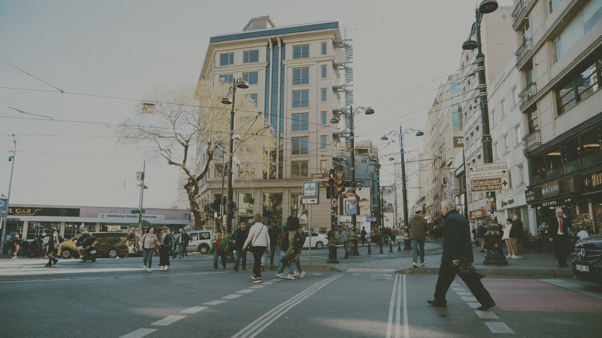
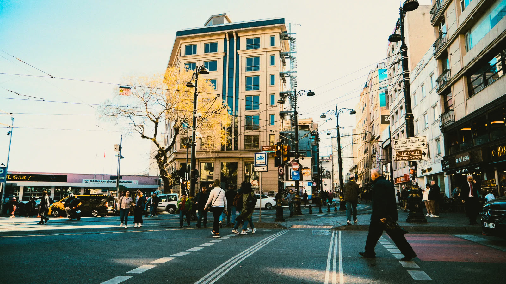
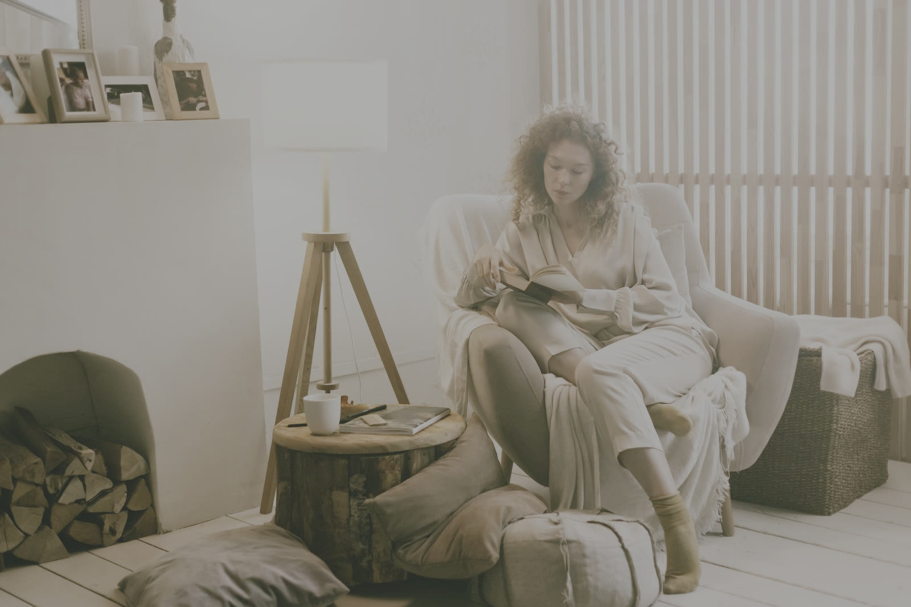
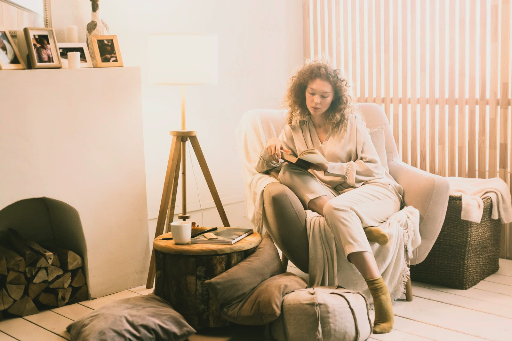
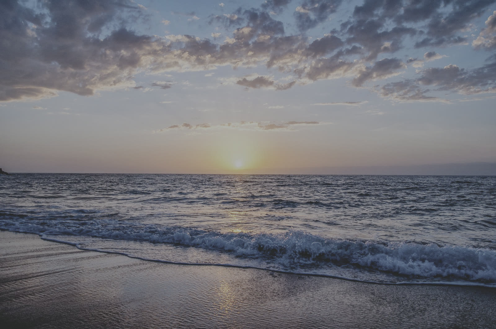
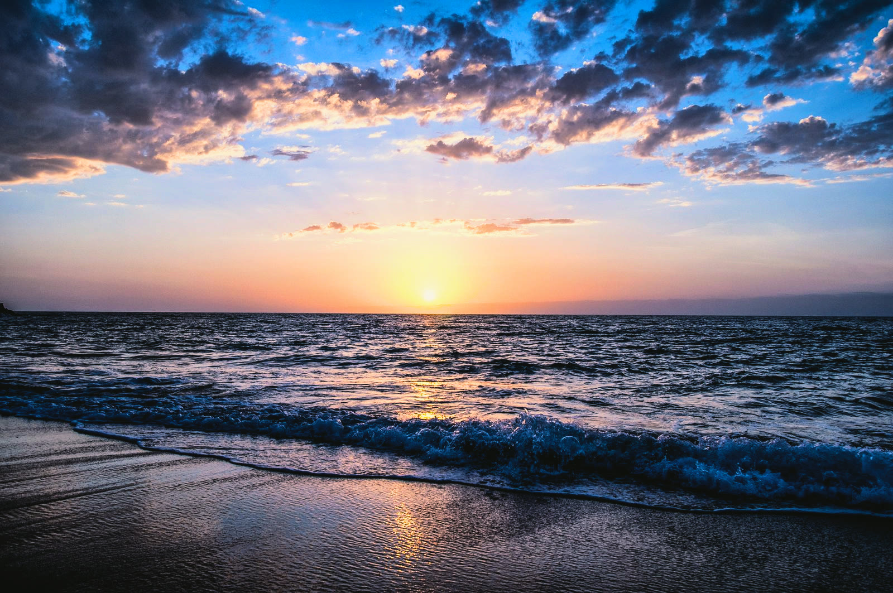
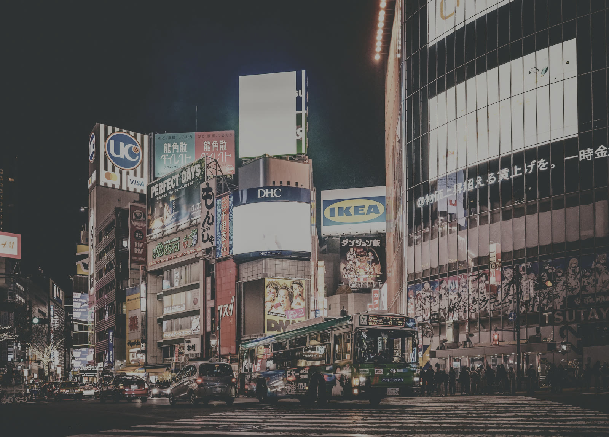
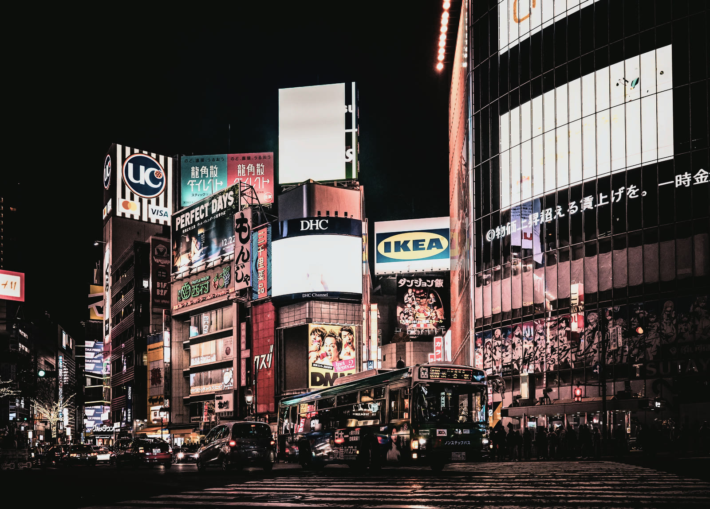

# iPhone 电影感摄影指南

**免费、开源的 iPhone 电影感拍摄 + Apple Log 2 调色完整指南：9 个实测过的免费 LUT、7 篇从设置到成片的指南、40 张前后对比样片。**

拍 Log 不是为了显得专业，是为了把手机传感器的宽容度用满。套一个为 Apple Log 2 实测过的 LUT，iPhone 拍出来的东西就能有电影感——不是滤镜那种假电影感，是曝光、色彩、影调都对的电影感。本仓库从拍摄设置讲到调色输出，跟着做一遍，就能完整跑通 iPhone 电影感的全流程。

> ⚠️ 本仓库所有 LUT **只适用于 Apple Log 2** 素材（iPhone 15 Pro 及之后机型 + Blackmagic Cam 等 App 拍摄），输出 Rec.709。不要用在一代 Apple Log 或普通视频上，会偏色、会发灰。

[English version / 英文版](README_EN.md)

## 效果预览：Log 原片 vs 套 LUT 之后

下面 4 组对比，左边是模拟 Apple Log 2 帧（灰、平），右边是套上 LUT 之后的效果。底图是 4 张真实照片（Pexels 免费授权），先按 Apple Log 2 曲线模拟成 Log 帧，再用 ffmpeg 实跑 LUT——不是 iPhone 直出，是用来看 LUT 性格的演示帧，做法见 [examples/README.md](examples/README.md)。

**Gold 金胶卷 v2 · 街头日光**

| Apple Log 2 模拟帧 | Gold 金胶卷 v2 |
|---|---|
|  |  |

**Portra 400 v2 · 室内暖光**

| Apple Log 2 模拟帧 | Portra 400 v2 |
|---|---|
|  |  |

**橙青大片 TealOrange · 落日海滩**

| Apple Log 2 模拟帧 | 橙青大片 |
|---|---|
|  |  |

**黑色电影 Noir · 夜景霓虹**

| Apple Log 2 模拟帧 | 黑色电影 Noir |
|---|---|
|  |  |

全部 40 张样片（4 个场景 × 10 个版本）和看图要点，见 [examples/README.md](examples/README.md)。

## 9 个 LUT

全部免费，33³ `.cube` 格式，可直接导入 Blackmagic Cam 做监看，也可在 DaVinci Resolve / Premiere Pro / Final Cut Pro 里套用。每个 LUT 都在 4 个场景上实跑过效果，见 [examples/](examples/)；v2 底子另在 iPhone 实拍素材的监看中验证过，不发灰。

| LUT | 文件 | 黑位 | 一句话 |
|---|---|---|---|
| Gold 金胶卷 v2 | `KodakFilm_AppleLog2_Rec709_v2.cube` | 0.065 | 暖而浓，最居中，第一次用就选它 |
| Portra 400 v2 | `KodakPortra_AppleLog2_Rec709_v2.cube` | 0.081 | 最柔和，饱和最克制，适合人像日常 |
| Ektar 100 v2 | `KodakEktar_AppleLog2_Rec709_v2.cube` | 0.066 | 最艳、对比最强，适合风景 |
| 橙青大片 TealOrange | `TealOrange_AppleLog2_Rec709.cube` | 0.057 | 高光偏橙、阴影偏青，好莱坞大片味 |
| 漂白旁路 BleachBypass | `BleachBypass_AppleLog2_Rec709.cube` | 0.042 | 低饱和、高对比，银灰冷峻 |
| 黑色电影 Noir | `Noir_AppleLog2_Rec709.cube` | 0.046 | 低调冷调、暗部最沉，适合夜景情绪片 |
| 暖调复古 WarmVintage | `WarmVintage_AppleLog2_Rec709.cube` | 0.081 | 黑位有意抬起的褪色感，暖黄怀旧 |
| 709 OETF 版 | `709_AppleLog2_Rec709.cube` | 0.0049 | 我自己的 709，偏冷偏暗电影感 |
| 709 Gamma 2.2 版 | `709_AppleLog2_Rec709_gamma22.cube` | 0.0049 | 同上，中间调和暗部更亮 |

完整清单（每个 LUT 的风格、适合场景、黑位特点、导入方法）见 [luts/README.md](luts/README.md)。

### 为什么是 v2 底子

第一版 Gold（无 v2 后缀）黑位抬到 0.104，室外大太阳下看着还行，一到室内偏暗场景就发灰——就是实测监看时说的“灰蒙蒙”那个问题。v2 底子把黑位压到约 0.065、对比拉更陡、曝光 +0.17 档、饱和 1.12，室内欠曝一档和室外实拍都验证过，不发灰。第一版已废弃，不在本仓库里。

例外：WarmVintage 黑位 0.081 是有意抬起的褪色感，Portra 黑位 0.081 是为了保留柔和感——这是风格，不是没修好。

## 为什么做这个仓库

市面上的 LUT，几乎都是给索尼 S-Log、佳能 C-Log、松下 V-Log 做的，专门给 iPhone Apple Log 2 做的胶片感 LUT 很少。拿索尼的 LUT 套 iPhone 素材，色彩空间不对，出来的东西总差一口气。

这 9 个 LUT 是为 Apple Log 2 从零手调的，调色效果在 iPhone 实拍素材的监看中验证过。第一版 Gold 就是在实测中翻车的——室外大太阳下看着好好的，一到室内偏暗场景就发灰。这个教训直接变成了本仓库的验收标准：只在明亮场景好看的 LUT，不发布；暗部必须过关。

另外，这些 LUT 不是从别处搬运、改名、打包的。每一个的曲线、饱和、黑位，都是结合 iPhone 实拍监看反馈反复调出来的。样片里的每一帧，都是用 ffmpeg 实跑对应 `.cube` 生成的（底图是真实照片，先模拟成 Log 帧再套 LUT），套上去就是这个效果，不存在“示意图仅供参考”。

## 怎么选第一个 LUT

不知道从哪个开始，按这个顺序试：

1. **先试 Gold 金胶卷 v2**：最居中，什么场景都不出错。拍一天下来，看看整体感觉对不对。
2. **按题材换**：拍人多，换 Portra；拍风景多，换 Ektar；拍夜景，换 Noir；想要大片感，换 TealOrange。
3. **按情绪换**：想要冷峻，BleachBypass；想要怀旧，WarmVintage；想要偏冷偏暗的电影感，试 709 两版。
4. **同一场景轮着监看**：Blackmagic Cam 里 9 个全导进去，站在同一个地方轮着切，哪个顺眼用哪个。别凭想象选，眼睛看到的才算数。

一个提醒：LUT 没有“最好”，只有“最适合这个场景”。Gold 在落日下好看，不代表在阴天也好看；Noir 在夜景里出彩，白天用就太沉了。养成按场景换 LUT 的习惯，比死守一个 LUT 重要。

## 从拍摄到成片：完整流程

1. **拍之前**：按 [06 iPhone 设置清单](guides/06-iphone-settings.md) 检查机型、存储、配件；按 [01 Blackmagic Cam 设置](guides/01-blackmagic-cam-setup.md) 改好 5 个设置。
2. **拍摄**：向右曝光、锁白平衡、慢运镜，每个镜头至少拍 5 秒。技巧见 [03 拍摄技巧](guides/03-shooting-techniques.md)。
3. **导入剪辑软件**：素材传到电脑，DaVinci Resolve 里粗剪。先剪辑、后调色。
4. **调色**：节点 1 修曝光白平衡 → 节点 2 套 LUT → 节点 3 微调饱和对比。详细流程见 [05 Resolve 调色流程](guides/05-davinci-resolve-grading.md)。
5. **输出**：按发布平台选分辨率和码率，检查一遍成片再发布。

## 新手最容易踩的 5 个坑

| 坑 | 后果 | 正确做法 |
|---|---|---|
| 用一代 Apple Log 拍，套 Log 2 的 LUT | 偏色，尤其是红蓝绿跑偏 | 拍摄前确认选的是 Apple Log 2 |
| 开了“将 LUT 烧录进视频” | Log 宽容度全丢，没法再调 | 监看 LUT 只监看，永远别烧录 |
| 快门速度太快（比如 1/500 秒） | 画面发干、发涩，像监控 | 快门角度锁 180° |
| 自动白平衡没锁 | 同一镜头色温来回跳 | 手动锁色温 |
| 欠曝拍摄 | 套什么 LUT 都灰、噪点爆炸 | 向右曝光，宁亮勿暗 |

更多问题见 [FAQ](guides/faq.md)，17 条常见问题基本覆盖了新手会遇到的所有情况。

## 实拍场景示例

三个真实场景，从拍摄设置到选 LUT，全流程示范：

**落日海边**：提前半小时到场，4K 24fps，快门 180°，白平衡手动锁 5200K（保留暖调），向右曝光但别让太阳附近的天空死白。监看用 Gold v2，想要更戏剧化换 TealOrange——落日的橙色高光和海面的青色阴影正好对撞。拍完套 LUT，强度 90%，饱和不用动。

**夜市霓虹**：4K 24fps，快门 180°，ISO 400–800（别超过 800），白平衡锁 4000K 左右。霓虹灯本身就是光源，别用闪光灯，别开夜间模式。监看用 Noir，暗部最沉，霓虹的色彩在暗底上会跳出来。套完 LUT 强度 85%，暗部如果死黑就提一点阴影。

**室内窗光人像**：让人侧对窗户，一边亮一边暗，4K 30fps，快门 180°，ISO 100–400，白平衡按光源定（晴天窗光约 5600K）。监看用 Portra v2，肤色最柔和。套完 LUT 强度 90%–100%，饱和不用加，Portra 本来就克制。注意别让窗外过曝死白——窗外死白了，后期拉不回来。

## 快速开始（3 步）

**第 1 步：下载 LUT**

点仓库右上角绿色的 `Code` 按钮 → `Download ZIP`，解压后在 `luts/` 文件夹里找到 9 个 `.cube` 文件。或者只下载你想要的那几个：点进 `luts/` 文件夹 → 点文件名 → 右上角 `Download raw file`。

**第 2 步：导入**

- **拍摄监看**：把 `.cube` 传到 iPhone 的“文件”App → Blackmagic Cam → 设置 → LUT → 导入。拍摄时在 LUT 列表里轮着切，同一场景看哪个顺眼用哪个。
- **后期套用**：DaVinci Resolve（调色页面 → 右键节点 → 3D LUT）、Premiere Pro（Lumetri 颜色 → 创意 → 浏览）、Final Cut Pro（效果 → 颜色 → 自定 LUT）。

**第 3 步：拍**

按 [01 Blackmagic Cam 设置全攻略](guides/01-blackmagic-cam-setup.md) 把 5 个设置改好（Apple Log 2、快门 180°、帧率锁死、手动白平衡、监看 LUT），就能开拍。拍完套 LUT、微调、输出，成片。

## 指南目录

7 篇指南，从设置到成片，按顺序读就是完整流程：

| 序号 | 指南 | 讲什么 |
|---|---|---|
| 01 | [Blackmagic Cam 设置全攻略](guides/01-blackmagic-cam-setup.md) | Log 格式、分辨率帧率、快门 180°、ISO、白平衡、LUT 监看导入 |
| 02 | [Apple Log 2 讲透](guides/02-apple-log2-explained.md) | 为什么拍 Log、宽容度、向右曝光、什么场景别用 Log |
| 03 | [拍摄技巧](guides/03-shooting-techniques.md) | 曝光、构图、运镜、光线、稳定器、常见错误 |
| 04 | [LUT 工作流](guides/04-lut-workflow.md) | 监看 LUT vs 输出 LUT、各软件导入方法、套完怎么微调 |
| 05 | [DaVinci Resolve 调色流程](guides/05-davinci-resolve-grading.md) | 节点顺序、套 LUT、微调、输出设置、批量调色 |
| 06 | [iPhone 拍摄设置清单](guides/06-iphone-settings.md) | 机型要求、系统设置、存储计算、配件推荐 |
| FAQ | [常见问题](guides/faq.md) | 17 条常见问题：发灰怎么办、安卓能用吗、商用授权等 |

## 仓库结构

```
iphone-cinematic-guide/
├── README.md                  你正在看的这篇（中文主文档）
├── README_EN.md               英文版主文档
├── LICENSE                    CC BY-NC-SA 4.0 许可全文
├── CONTRIBUTING.md            如何投稿、提建议、报问题
├── luts/                      9 个 .cube 文件 + 清单说明
├── examples/                  40 张样片（4 个场景 × 10 张）
│   ├── street/                街头日光：Log 模拟帧 + 9 个调色版
│   ├── sunset/                落日海滩：Log 模拟帧 + 9 个调色版
│   ├── night/                 夜景霓虹：Log 模拟帧 + 9 个调色版
│   └── indoor/                室内暖光：Log 模拟帧 + 9 个调色版
└── guides/                    7 篇指南 + FAQ
```

只想拿 LUT 的话，直接进 `luts/` 下载就行，不用看指南。想从零学会整套流程，按指南目录的顺序读 01 到 06。

## 获取更新

新 LUT 和新指南发布时，会直接更新到这个仓库。点仓库右上角的 `Watch` 可以收到更新通知。更新标准和现在一样：新 LUT 必须在多个真实场景和实拍素材上验证过、黑位和暗部过关才发布，不会为了凑数量发没验证过的版本。

## 适用范围

- **机型**：iPhone 15 Pro / 15 Pro Max 及之后（16 Pro、17 Pro 都行）。非 Pro 机型没有 Log 功能。
- **拍摄 App**：Blackmagic Cam（推荐，免费、全手动、支持监看 LUT）、系统相机 App（ProRes Log 模式）。
- **剪辑软件**：DaVinci Resolve（免费版就够）、Premiere Pro、Final Cut Pro、DaVinci Resolve for iPad、LumaFusion。
- **素材**：必须是 Apple Log 2。一代 Apple Log、普通视频、安卓 Log 都不适用。

## 许可

本仓库（文档、LUT、样片）全部遵循 **CC BY-NC-SA 4.0**：

- ✅ 免费使用、免费分享
- ✅ 可以改、可以再分享（改完必须用同样的许可）
- ✅ 用 LUT 调出来的视频可以商用（视频是你拍的，版权是你的）
- ❌ **禁止把 LUT 文件本身拿去售卖、打包进付费产品**
- ❌ 改完不能闭源、不能去掉署名

署名方式：注明作者 Kai，并附上本仓库链接。全文见 [LICENSE](LICENSE)。

## 作者

- TikTok：[待填写：你的 TikTok 主页链接]
- LUT 展示页：[待填写：LUT 展示页链接]

## 参与贡献

欢迎提 Issue（报问题、提建议、想要的 LUT 风格）和投稿指南、翻译。具体流程见 [CONTRIBUTING.md](CONTRIBUTING.md)。

提 Issue 时说清三件事最有帮助：你用的机型和拍摄 App、你套的是哪个 LUT、问题具体表现是什么（最好附一张截图）。只写“用不了”没法定位问题。文档有错误（错别字、错误的参数、过时的操作步骤）也欢迎直接提 Issue 或者提交 Pull Request 修正。
