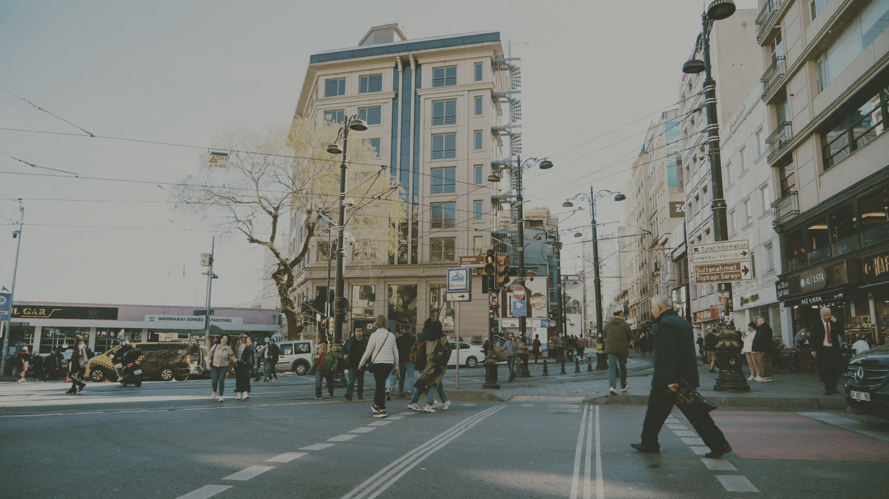
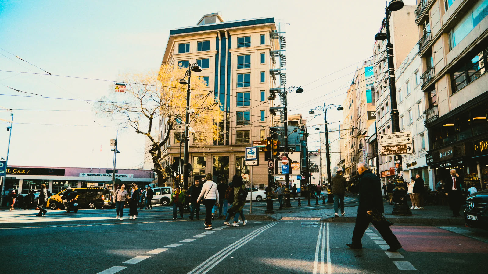
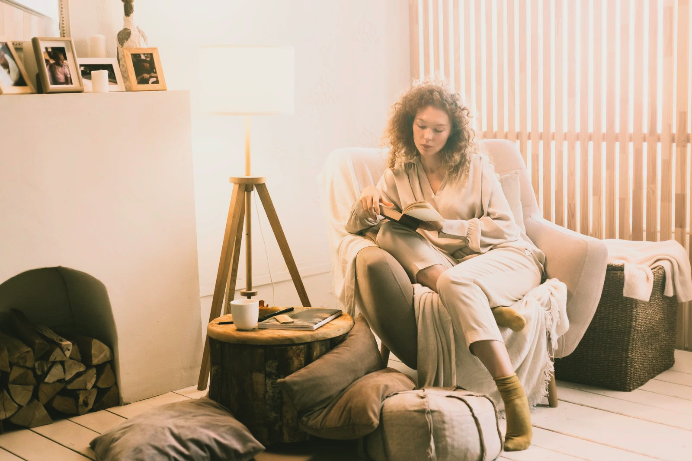
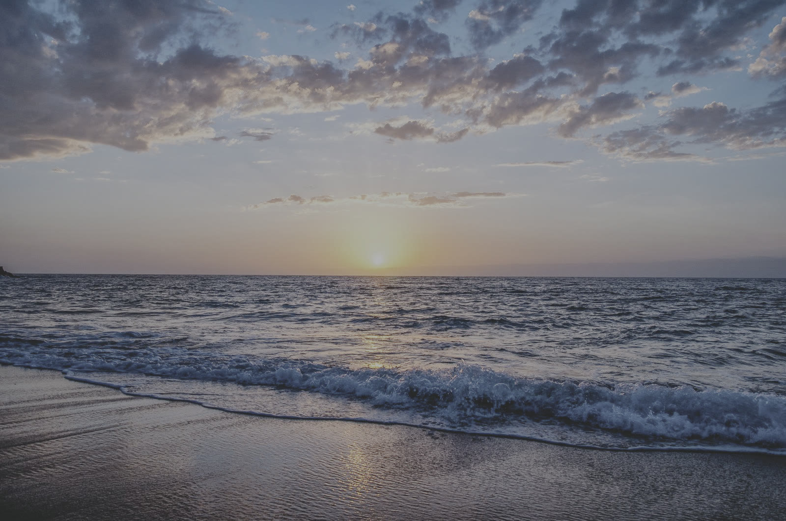
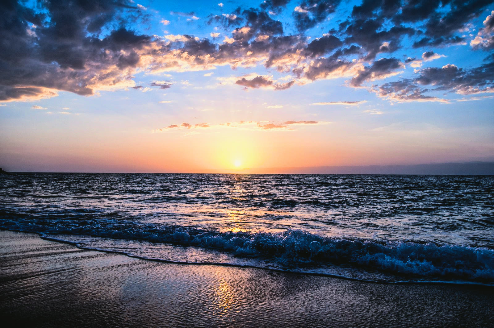
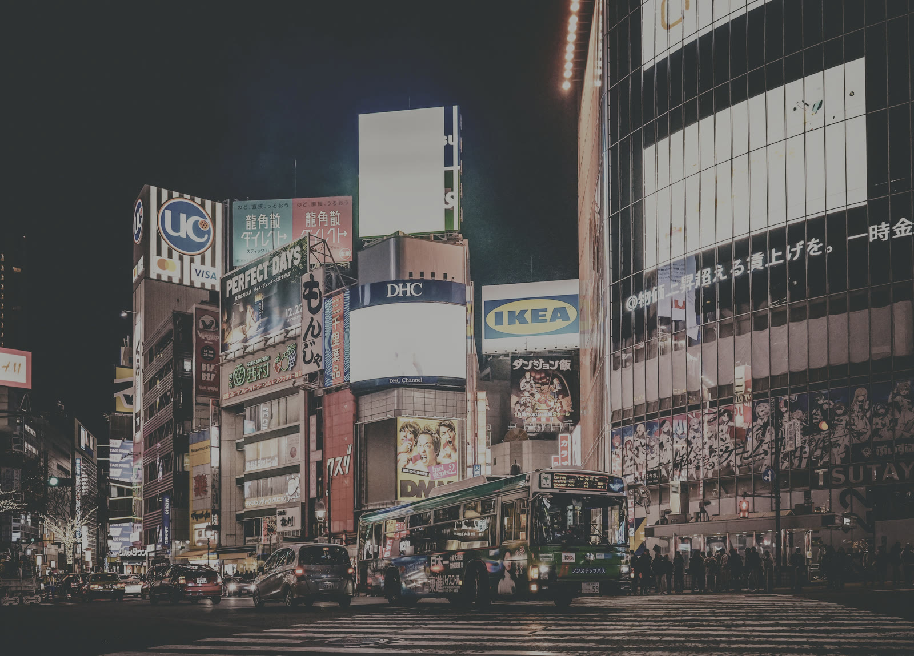
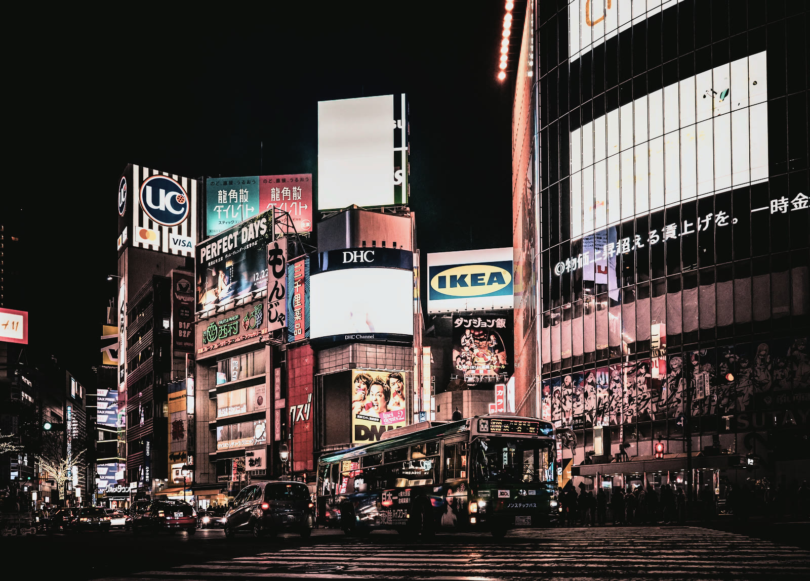

# iPhone Cinematic Photography Guide

**A free, open-source guide to cinematic iPhone shooting and Apple Log 2 color grading: 9 tested LUTs, 7 step-by-step guides, and 40 before/after samples.**

Shooting Log isn't about looking professional — it's about using the full dynamic range your phone's sensor can capture. Pair that with a LUT actually tested on Apple Log 2, and iPhone footage starts to look like cinema. Not filter-fake cinema: exposure, color, and tone that are genuinely right.

> ⚠️ Every LUT in this repo is built for **Apple Log 2 only** (iPhone 15 Pro and later, shot with Blackmagic Cam or similar apps). Output is Rec.709. Do not use them on first-generation Apple Log or regular SDR video — colors will shift and shadows will go milky.

[中文版 / Chinese version](README.md)

## Before & After: Log vs Graded

Four comparisons below. Left is the flat, gray simulated Apple Log 2 frame; right is the same frame with a LUT applied. The base images are four real photos (free license from Pexels), converted to Log 2 with the Apple Log curve and graded with ffmpeg — not iPhone footage, but demonstration frames that show each LUT's character. Full method: [examples/README.md](examples/README.md).

**Gold v2 · Street daylight**

| Simulated Apple Log 2 | Gold v2 |
|---|---|
|  |  |

**Portra 400 v2 · Warm indoor light**

| Simulated Apple Log 2 | Portra 400 v2 |
|---|---|
|  |  |

**Teal & Orange · Beach sunset**

| Simulated Apple Log 2 | Teal & Orange |
|---|---|
|  |  |

**Noir · Neon night**

| Simulated Apple Log 2 | Noir |
|---|---|
|  |  |

All 40 samples (4 scenes × 10 versions) and viewing notes: [examples/README.md](examples/README.md).

## The 9 LUTs

All free, 33³ `.cube` files. Import into Blackmagic Cam for on-set monitoring, or apply in DaVinci Resolve / Premiere Pro / Final Cut Pro. Each one has been run on all four sample scenes — see [examples/](examples/) — and the v2 base was additionally verified on real iPhone footage during on-device monitoring.

| LUT | File | Black point | In one line |
|---|---|---|---|
| Gold v2 | `KodakFilm_AppleLog2_Rec709_v2.cube` | 0.065 | Warm and rich, the all-rounder — start here |
| Portra 400 v2 | `KodakPortra_AppleLog2_Rec709_v2.cube` | 0.081 | Softest, most restrained saturation; great for portraits |
| Ektar 100 v2 | `KodakEktar_AppleLog2_Rec709_v2.cube` | 0.066 | Boldest colors, strongest contrast; made for landscapes |
| TealOrange | `TealOrange_AppleLog2_Rec709.cube` | 0.057 | Orange highlights, teal shadows — the blockbuster look |
| BleachBypass | `BleachBypass_AppleLog2_Rec709.cube` | 0.042 | Desaturated, high contrast, cold silver |
| Noir | `Noir_AppleLog2_Rec709.cube` | 0.046 | Low-key and cold, deepest shadows; night and mood pieces |
| WarmVintage | `WarmVintage_AppleLog2_Rec709.cube` | 0.081 | Lifted blacks for a faded-film feel, warm and nostalgic |
| 709 OETF | `709_AppleLog2_Rec709.cube` | 0.0049 | My own 709 look, cool and dark cinematic |
| 709 Gamma 2.2 | `709_AppleLog2_Rec709_gamma22.cube` | 0.0049 | Same look, brighter midtones and shadows |

Full details (style, best scenes, black-point notes, import steps): [luts/README.md](luts/README.md).

### Why v2

The first Gold (no v2 suffix) had its black point lifted to 0.104. It looked fine in bright sunlight but went milky gray indoors in dim light — exactly the problem spotted during real monitoring tests. The v2 base pulls the black point down to ~0.065, steepens the contrast curve, adds +0.17 stops of exposure and 1.12 saturation, and is verified on both underexposed indoor frames and outdoor footage. The v1 is deprecated and not in this repo.

Two deliberate exceptions: WarmVintage (0.081) keeps lifted blacks for its faded-film look, and Portra (0.081) keeps them for softness. That's the style, not a flaw.

## Quick Start (3 Steps)

**Step 1: Download the LUTs**

Click the green `Code` button → `Download ZIP`, then find the 9 `.cube` files in the `luts/` folder. Or download individual files: open `luts/`, click a filename, then `Download raw file`.

**Step 2: Import**

- **On-set monitoring**: send the `.cube` files to your iPhone's Files app → Blackmagic Cam → Settings → LUT → Import. Cycle through them on the same scene and pick what looks right.
- **In post**: DaVinci Resolve (Color page → right-click node → 3D LUT), Premiere Pro (Lumetri Color → Creative → Browse), Final Cut Pro (Effects → Color → Custom LUT).

**Step 3: Shoot**

Follow the [Blackmagic Cam setup guide](guides/01-blackmagic-cam-setup.md) — five settings (Apple Log 2, 180° shutter, locked frame rate, manual white balance, monitoring LUT) — and you're ready. Shoot, apply the LUT, fine-tune, export.

## Guides

Seven guides, in order, take you from setup to finished film. (Guides are in Chinese for now; translations welcome — see [CONTRIBUTING.md](CONTRIBUTING.md).)

| # | Guide | Covers |
|---|---|---|
| 01 | [Blackmagic Cam Setup](guides/01-blackmagic-cam-setup.md) | Log format, resolution/frame rate, 180° shutter, ISO, white balance, monitoring LUT import |
| 02 | [Apple Log 2 Explained](guides/02-apple-log2-explained.md) | Why shoot Log, dynamic range, expose to the right, when not to use Log |
| 03 | [Shooting Techniques](guides/03-shooting-techniques.md) | Exposure, composition, camera movement, light, stabilizers, common mistakes |
| 04 | [LUT Workflow](guides/04-lut-workflow.md) | Monitoring vs output LUTs, import in each app, fine-tuning after applying |
| 05 | [DaVinci Resolve Grading](guides/05-davinci-resolve-grading.md) | Node order, applying LUTs, fine-tuning, export settings, batch grading |
| 06 | [iPhone Settings Checklist](guides/06-iphone-settings.md) | Model requirements, system settings, storage math, accessory picks |
| FAQ | [FAQ](guides/faq.md) | 17 questions: milky shadows, Android, commercial licensing, and more |

## Compatibility

- **Phones**: iPhone 15 Pro / 15 Pro Max and later (16 Pro, 17 Pro). Non-Pro models can't shoot Log.
- **Camera apps**: Blackmagic Cam (recommended — free, full manual, monitoring LUTs), or the stock Camera app in ProRes Log mode.
- **Editing apps**: DaVinci Resolve (free version is enough), Premiere Pro, Final Cut Pro, DaVinci Resolve for iPad, LumaFusion.
- **Footage**: Apple Log 2 only. First-gen Apple Log, regular SDR video, and Android Log formats won't work correctly.

## License

Everything in this repo (docs, LUTs, samples) is under **CC BY-NC-SA 4.0**:

- ✅ Free to use and share
- ✅ Free to adapt and re-share (under the same license)
- ✅ Videos you grade with these LUTs can be used commercially (the footage is yours)
- ❌ **You may not sell the LUT files or bundle them into a paid product**
- ❌ Adaptations must stay open and keep the attribution

Attribution: credit Kai and link back to this repo. Full text: [LICENSE](LICENSE).

## Author

- TikTok: [待填写：你的 TikTok 主页链接]
- LUT showcase page: [待填写：LUT 展示页链接]

## Contributing

Issues (bug reports, suggestions, LUT requests) and contributions (guides, translations) are welcome. See [CONTRIBUTING.md](CONTRIBUTING.md).
